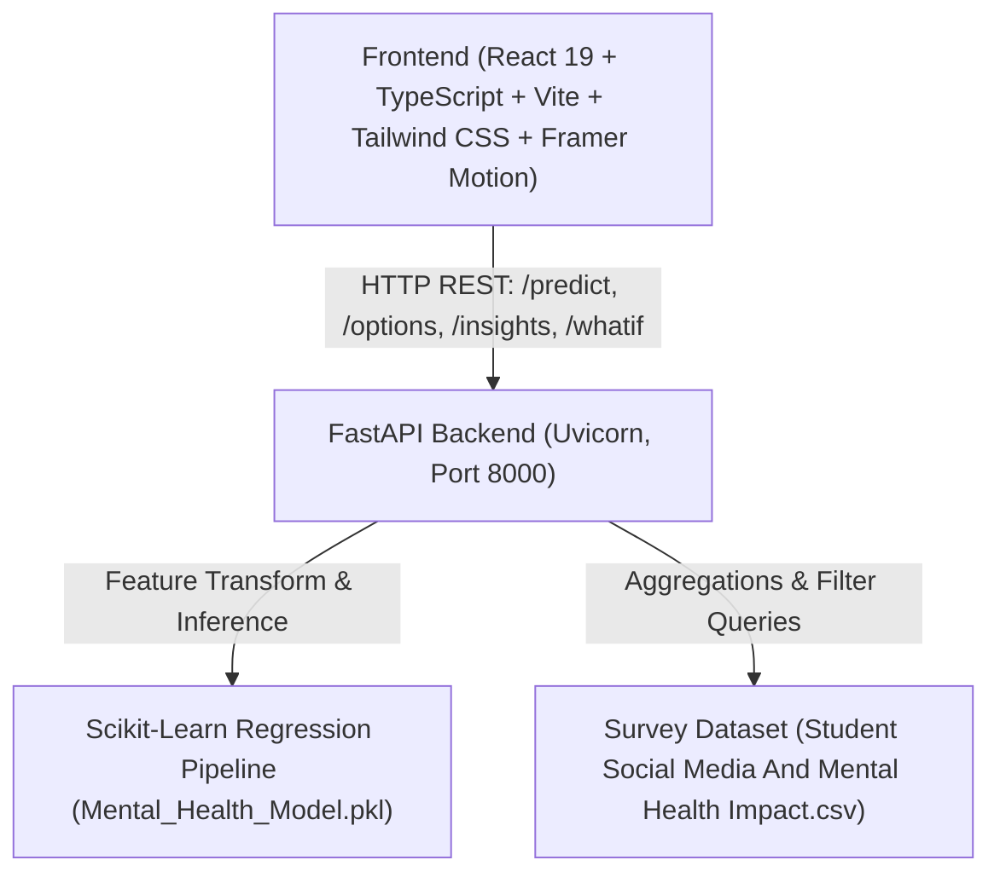

# 🧠 MindScroll AI: Student Social Media & Mental Health Impact Predictor

> **Predict and understand how daily screen time, social applications, and lifestyle habits impact student mental health using machine learning.**

[](https://python.org)
[](https://fastapi.tiangolo.com)
[](https://scikit-learn.org)
[](https://react.dev)
[](https://vitejs.dev)
[](https://tailwindcss.com)
[](https://www.docker.com/)

---

## 📋 Table of Contents
- [Project Overview](#-project-overview)
- [Architecture & Tech Stack](#-architecture--tech-stack)
- [Model Pipeline & Benchmarks](#-model-pipeline--benchmarks)
- [Directory Structure](#-directory-structure)
- [Quickstart Guide](#-quickstart-guide)
  - [Option A: Running with Docker Compose (One-Command)](#option-a-running-with-docker-compose-one-command)
  - [Option B: Running Locally (Development)](#option-b-running-locally-development)
  - [Option C: Deploying to Vercel (Multi-Service Project)](#option-c-deploying-to-vercel-multi-service-project)
- [API Documentation](#-api-documentation)
- [Themes and Animations](#-themes-and-animations)
- [Performance & Accessibility](#-performance--accessibility)
- [Responsive Support (All Screen Sizes)](#-responsive-support-all-screen-sizes)
- [Application Features](#-application-features)
- [Screenshots & UI Showcase](#-screenshots--ui-showcase)
- [Known Limitations & Ethics](#-known-limitations--ethics)
- [License](#-license)

---

## 🌟 Project Overview

**MindScroll AI** is a production-grade full-stack web application designed for students, educators, and researchers. It utilizes a scikit-learn regression pipeline trained on **5,000 student survey responses** (`Student Social Media And Mental Health Impact.csv`) to predict a student's **Mental Health Score** (scale: 3.6 to 9.4) from digital habits and lifestyle metrics.

### Key Highlights:
- **Cinematic Dark Theme Design System**: Built with deep near-black palettes (`#0A0A0A`), vibrant orange gradients (`#FF6B1A` to `#FF8A3D`), backdrop blur glassmorphism, and responsive micro-animations.
- **Custom Animated SVG Score Gauge**: Semicircular progress gauge that smoothly sweeps to the predicted wellness score, with dynamic color bands and percentile rank.
- **Interactive Multi-Step Wizard**: 4-step assessment with live sliders, segmented controls, and client-side input bounds validation.
- **Driving Factors Waterfall**: Model-based impact breakdown highlighting which variables buffer or strain your score relative to population averages.
- **What-If Habit Simulator**: Real-time debounced simulation comparing baseline scores against hypothetical lifestyle changes (+0.4 / -0.7 delta badge).
- **Interactive Insights Dashboard**: 6 exploratory charts (Score distribution histogram, Usage vs. Score scatter, Stress level breakdown, Sleep duration curves, Platform counts, and a Pearson Correlation heatmap) with dynamic cohort filtering.
- **Model Card & Transparency**: Full ML audit with cross-model benchmarks (Linear Regression vs. Random Forest vs. Tuned RF), preprocessing pipelines, and limitations.
- **PDF Report Generation**: Instant printable client report with full assessment snapshot and recommendations.

---

## 🛠 Architecture & Tech Stack



- **Frontend**:
  - React 19 + TypeScript + Vite
  - Tailwind CSS with custom glassmorphism design tokens
  - Framer Motion for staggered card entrances, page transitions, and spring animations
  - Recharts for data visualizations
  - Lucide React for consistent iconography
  - Canvas Confetti for high-score celebration states
- **Backend**:
  - FastAPI (Python 3.11 / 3.14) with Uvicorn server
  - Scikit-Learn 1.9.1 (pinned pipeline matching model training)
  - Pandas & NumPy for vectorized feature preprocessing and insights aggregation
  - Joblib for model serialization
  - Pydantic v2 for strict request validation and schema definition
  - CORS middleware enabled for cross-origin access

---

## 📊 Model Pipeline & Benchmarks

The regression pipeline was trained with a 70/30 train/test split over 4,998 clean student records.

### Feature Preprocessing (`ColumnTransformer`):
1. **Skewed Numerical** (`Study_Hours`): `FunctionTransformer(np.log1p)` followed by `StandardScaler()`.
2. **Standard Numerical** (`Age`, `Avg_Daily_Usage_Hours`, `Daily_Unlocks`, `Physical_Activity_Hours`, `Sleep_Hours_Per_Night`): `StandardScaler()`.
3. **Ordinal Feature** (`Stress_Level`): `OrdinalEncoder(categories=[['Low', 'Medium', 'High', 'Very High']])`.
4. **Categorical Features** (`Gender`, `Grouped_country`, `Academic_Level`, `Most_Used_Platform`, `Purpose_Of_Use`): `OneHotEncoder(handle_unknown='ignore')`.
   * *Note: The backend dynamically computes the top 10 most frequent countries and groups all others into `"Other"`.*

### Benchmark Comparison:
| Model Pipeline | Test R² | Train R² | MAE | RMSE | Deployment Status |
| :--- | :---: | :---: | :---: | :---: | :---: |
| **Linear Regression** | 0.7398 | 0.7237 | 0.5362 | 0.6760 | Baseline |
| **Random Forest (Default)** | 0.8778 | 0.9810 | 0.3470 | 0.4632 | Benchmark |
| **Random Forest (Tuned)** | **0.8640** | **0.9533** | **±0.3708** | **0.4887** | **Active Production** |

*Tuned Hyperparameters:* `n_estimators=100`, `max_depth=15`, `min_samples_split=5`, `min_samples_leaf=2`.

---

## 📁 Directory Structure

```
Mental-Health-Score/
├── backend/
│   ├── app/
│   │   ├── __init__.py
│   │   ├── main.py              # FastAPI application, CORS, lifecycle, routes
│   │   ├── schemas.py           # Pydantic request & response models
│   │   ├── model.py             # Model inference, what-if engine & feature impact
│   │   ├── data_service.py      # Insights aggregation & CSV range calculations
│   │   └── advice.py            # Personalized non-clinical lifestyle guidance
│   ├── Mental_Health_Model.pkl   # Serialized scikit-learn regression pipeline
│   ├── model_evaluation.json    # Benchmark metrics & model card dataset stats
│   ├── Student Social Media...csv # Empirical student dataset
│   ├── requirements.txt         # Pinned backend dependencies (scikit-learn==1.9.1)
│   ├── Dockerfile               # Backend production container
│   └── .env.example             # Backend environment template
├── frontend/
│   ├── public/
│   │   └── favicon.svg          # MindScroll SVG icon
│   ├── src/
│   │   ├── components/          # ScoreGauge, ProgressRing, Navbar, Footer, GlassCard, etc.
│   │   ├── pages/               # LandingPage, PredictorWizard, ResultPage, SimulatorPage, InsightsPage, ModelCardPage, NotFoundPage
│   │   ├── hooks/               # useTheme (dark/light), useHistory, usePredict
│   │   ├── lib/                 # api.ts, utils.ts
│   │   ├── types/               # api.ts
│   │   ├── App.tsx              # Root application router & state
│   │   ├── main.tsx             # DOM mount point
│   │   ├── index.css            # Custom CSS, glassmorphism tokens & print rules
│   │   └── vite-env.d.ts        # Vite environment typings
│   ├── index.html               # Head tags, Google Fonts (Space Grotesk & Inter)
│   ├── package.json             # Frontend dependencies & scripts
│   ├── tailwind.config.js       # Color tokens, fonts, and dark mode configuration
│   ├── tsconfig.json            # Strict TypeScript configuration
│   ├── vite.config.ts           # Vite proxy & build configuration
│   ├── nginx.conf               # Production Nginx reverse proxy configuration
│   ├── Dockerfile               # Frontend production multi-stage container
│   └── .env.example             # Frontend environment template
├── docker-compose.yml           # One-command orchestration configuration
├── health.py                    # Original Colab exploration script
├── train_model.py               # Standalone model training and verification script
└── README.md                    # Project documentation
```

---

## 🚀 Quickstart Guide

### Option A: Running with Docker Compose (One-Command)

Ensure you have [Docker](https://www.docker.com/) and [Docker Compose](https://docs.docker.com/compose/) installed:

```bash
# Clone or navigate to the repository
cd Mental-Health-Score

# Launch both frontend and backend
docker-compose up --build
```

- **Frontend Application**: `http://localhost:3000`
- **Backend API**: `http://localhost:8000`
- **Interactive Swagger Docs**: `http://localhost:8000/docs`

---

### Option B: Running Locally (Development)

#### 1. Backend Setup (FastAPI)
```bash
# Navigate to the backend directory
cd backend

# Create a virtual environment (optional but recommended)
python -m venv venv
# Windows:
venv\Scripts\activate
# Linux/macOS:
source venv/bin/activate

# Install dependencies
pip install -r requirements.txt

# Start the FastAPI server
python -m uvicorn app.main:app --host 0.0.0.0 --port 8000 --reload
```
The backend will be live at `http://localhost:8000`. Test health status at `http://localhost:8000/health`.

#### 2. Frontend Setup (React + Vite)
In a separate terminal:
```bash
# Navigate to the frontend directory
cd frontend

# Install node packages
npm install

# Start Vite development server
npm run dev
```
Open `http://localhost:5173` in your browser.

---

### Option C: Deploying to Vercel (Multi-Service Project)

MindScroll AI includes built-in native support for [Vercel Multi-Service Projects](https://vercel.com/docs/services) via the root [`vercel.json`](./vercel.json):

1. **Deploy to Vercel**: Import this GitHub repository into your Vercel Dashboard as a single project.
2. **Architecture**:
   - `frontend` service builds the Vite + React client application.
   - `backend` service runs the FastAPI + Scikit-Learn serverless ML pipeline.
   - Top-level rewrite routes `/(.*)` to `frontend` and `/api/(.*)` to `backend`.
   - Internal binding injects `BACKEND_URL` into the frontend service.
3. **Local Emulation via Vercel CLI**:
   ```bash
   vercel dev
   ```

---

## 📡 API Documentation

### 1. `GET /health`
Returns system health, dataset load status, and model pipeline readiness.

### 2. `GET /options`
Returns dynamically extracted categories and numeric bounds directly from the dataset:
- `genders`, `countries`, `top_10_countries`, `academic_levels`, `platforms`, `purposes`, `stress_levels`
- `numeric_ranges`: min, max, mean, median, step for each numerical attribute
- `score_bounds`: min (3.6), max (9.4), mean (6.23)

### 3. `POST /predict`
Performs regression inference on a student's profile.
**Sample Request:**
```json
{
  "Age": 21,
  "Gender": "Female",
  "Country": "USA",
  "Academic_Level": "Undergraduate",
  "Most_Used_Platform": "Instagram",
  "Purpose_Of_Use": "Entertainment",
  "Avg_Daily_Usage_Hours": 6.5,
  "Daily_Unlocks": 95,
  "Study_Hours": 4.0,
  "Physical_Activity_Hours": 0.5,
  "Sleep_Hours_Per_Night": 5.5,
  "Stress_Level": "High"
}
```
**Sample Response:**
```json
{
  "score": 5.06,
  "band": "Needs Attention",
  "band_color": "#EF4444",
  "band_description": "High screen time exposure and sleep or activity deficits are placing noticeable strain on your cognitive well-being.",
  "percentile": 24.0,
  "confidence_note": "Random Forest Regression (R² = 0.864, MAE = ±0.37 on validation split).",
  "top_factors": [
    {
      "factor": "Daily Screen Time",
      "impact": "negative",
      "weight": -0.63,
      "description": "6.5 hrs/day is 1.4h higher than the student average (5.1h), lowering wellness index."
    },
    {
      "factor": "Sleep Duration",
      "impact": "negative",
      "weight": -0.42,
      "description": "5.5 hrs/night is below average (6.6h), increasing cognitive fatigue."
    }
  ],
  "suggestions": [
    {
      "title": "Implement Screen-Free Micro Breaks",
      "description": "Your current daily usage is 6.5h. Trying a 20-20-20 rule or setting a 45-minute daily timer for Instagram can significantly reduce digital cognitive load.",
      "category": "screen_time",
      "icon": "Smartphone"
    }
  ],
  "disclaimer": "Educational research demonstration only. Not intended as a psychological or medical diagnosis."
}
```

### 4. `POST /whatif`
Simulates score adjustments when modifying variables (e.g. sleep duration, screen time, stress).
Returns `baseline_score`, `predicted_score`, and `delta` (+0.4 / -0.7).

### 5. `GET /insights`
Returns precomputed aggregations for dashboard visualization.
Supports query filters: `?gender=Female&academic_level=Undergraduate&country=USA`.

### 6. `GET /model-card`
Returns complete model comparison benchmarks, training hyper-parameters, and pipeline metadata.

---

## 🎨 Design System: "The Scroll Leaves a Mark"

MindScroll AI merges the best elements of world-class design systems into one cohesive, award-level experience under the central narrative: **"Your daily scroll adds up. Turn invisible habits into a visible, beautiful signal."**

```
+-----------------------------------------------------------------------------------+
|                            THE SCROLL LEAVES A MARK                               |
|                                                                                   |
|  [ Vertex3D ]          [ Riotters ]           [ DashDigital ]       [ Portfolio ] |
|  - Preloader (0-100%)  - Bold 2-line hero     - Editorial type      - Plate tags  |
|  - Bracket navigation  - Proof number strip   - "Menu +" overlay    - Interactive |
|  - 3D Signal Orb       - 4-step stepper       - Expandable rows       pipeline    |
|  - Bracket buttons     - Playful micro-copy   - "Next Page" footer    explorer    |
+-----------------------------------------------------------------------------------+
```

### 1. Unified Design Language
- **From Vertex3D**:
  - `Preloader`: 0-100% counter with live SVG signal wave drawing and curtain reveal (runs once per session; respects `prefers-reduced-motion`).
  - Bracket Navigation: `[ Home ] [ Predict ] [ Simulator ] [ Insights ] [ Model ]`.
  - Numbered Section Labels: `01 // THE SCROLL LEAVES A MARK`, `02 // HOW THE MODEL THINKS`, `03 // HOW IT WORKS`.
  - Mixed-weight Headings: `Your scroll, *decoded*`.
  - 3D Signal Element: `SignalOrb3D` built with Three.js WebGL particle simulation with orbit rings, responding dynamically to user wellness state.
  - Bracket Buttons: `[ CHECK MY SCORE ]`, `[ RUN INFERENCE ]`, `[ TRY WHAT-IF ]`.
- **From Riotters**:
  - Pinned 3-beat hero story with split-text reveal.
  - Live empirical proof numbers strip counting up (`5,000` students, `12` lifestyle features, `0.864` model R², `10+` global regions).
  - Numbered 4-step "How it works" stepper with Prev/Next controls.
  - Signature accent with playful micro-copy (`"Don't worry—we don't judge your 2 AM memes"`).
- **From DashDigital**:
  - Large editorial typography with generous whitespace.
  - Full-screen "Menu +" navigation overlay with item counts and atlas metadata.
  - Expandable accordion rows (`More +` / `Less -`) for model card hyperparameters and FAQs.
  - Contextual "Next Page" footer preview block linking sequentially to the next experience.
  - Smooth "Back to top" floating control.
- **From the Portfolio Pipeline Explorer**:
  - `Plate 01`, `Plate 02`, `Plate 03`, `Plate 04` numbering across cards.
  - Interactive "How the model thinks" pipeline explorer (Student Inputs $\rightarrow$ Preprocessing $\rightarrow$ Random Forest $\rightarrow$ Score Synthesis) with arrow-key navigation, auto-play mode, and live JSON I/O inspection.
  - Scrolling infinite ticker of platform names (`PlatformMarquee`).
  - Single-click "Copy Summary" clipboard generator on assessment results.
- **CardioDetect ML Platform Feel**:
  - Clear "Educational research platform" tone.
  - Prominent non-clinical disclaimer banners.
  - Open model card transparency specification with cross-model metrics.

### 2. Color Tokens & Visual System
- **Dark Theme (`[data-theme="dark"]`)**:
  - Base: `#0A0A0A`
  - Cards: `#121212` with frosted glass backdrop blur
  - Primary Accent: Gradient from `#FF6B1A` to `#FF8A3D`
  - Secondary: Cool cyan / teal glow `#38BDF8`
  - Borders: Hairline `rgba(255, 255, 255, 0.08)`
  - Film Grain: SVG noise overlay
- **Light Theme (`[data-theme="light"]`)**:
  - Base: Warm cream `#FFF8F1`
  - Cards: Pure white frosted glass `rgba(255, 255, 255, 0.85)`
  - Ink Typography: `#1A1410`
  - Primary Accent: Rich peach gradient `#FF6B1A` to `#F97316`
  - Shadows: Soft diffuse warm drop-shadows
- **Typography Hierarchy**:
  - Display: `Space Grotesk` (Google Fonts) with fluid `clamp()` sizing
  - Body: `Inter`
  - Telemetry & Labels: `JetBrains Mono`

---

## 🎨 Themes and Animations

MindScroll AI features an award-winning (Awwwards / Linear / Vercel level) visual and motion architecture designed for delight, usability, and speed:

### 1. Dual-Theme Architecture (`Dark`, `Light`, `System`)
- **Zero-FOUC Guarantee**: Inline theme detection script in `index.html` resolves `localStorage` or `prefers-color-scheme` before the first paint cycle.
- **CSS Semantic Tokens**: 100% of interface colors are mapped via CSS variables (`:root` and `[data-theme="dark"|"light"]`) through Tailwind utility tokens. No hardcoded hex values exist in component layers.
  - **Dark Mode**: Near-black `#0A0A0A` base, elevated `#121212` glass surfaces, vibrant orange gradient accent (`#FF6B1A` to `#FF8A3D`), and luminous borders.
  - **Light Mode**: Warm cream base (`#FFF8F1`), frosted white glass cards, crisp dark-ink typography (`#1A1410`), and soft peach shadows.
- **Showpiece Theme Toggle**:
  - Interactive SVG morphing button featuring rotating sun rays, animated moon craters, star glints, spring bounce, and radiant back-glow.
  - **Circular Expansion Reveal**: Utilizes the native **View Transitions API** (`document.startViewTransition`) with radial clipping (`clip-path: circle()`) anchored dynamically to the cursor's click coordinates. Gracefully falls back to a 0.4s smooth cross-fade when unsupported.
  - Keyboard trigger: Press **"T"** anywhere to switch themes with full keyboard accessibility.

### 2. Motion & Interactive Physics
- **Background Atmosphere**:
  - `AuroraBackground`: Drifting theme-adaptive orange, amber, and violet mesh gradient blobs.
  - `ParticleField`: Canvas-based interactive particle field with mouse attraction and parallax drift. Automatically pauses when browser tabs are inactive (`visibilitychange`).
  - `NoiseOverlay`: Ultra-fine SVG film grain texture overlay.
- **Cinematic Landing & Hero**:
  - `HeroPhoneOrbit`: 3D CSS perspective phone mock-up with a glowing mini-gauge and orbiting social platform icons (Instagram, TikTok, YouTube, Snapchat, X).
  - `SplitText`: Masked staggered reveal for words and characters.
  - `PlatformMarquee`: Seamless infinite ticker of analyzed social networks.
  - **Lenis Smooth Scroll**: Inertia scrolling utilizing `overflow-x: clip` on the viewport to maintain reliable `position: sticky` behavior.
- **Micro-Interactions**:
  - `CustomCursor`: Magnetic trailing elastic ring with contextual action badges (`Explore`, `View`, `Drag`), automatically disabled on mobile and touch devices.
  - `MagneticButton`: Physical spring cursor-pull physics with ripple click waves.
  - `TiltCard`: Gyroscopic 3D perspective tilt with a dynamic specular glare tracking the mouse.
  - `SpotlightCard`: Radial spotlight glow tracking across cards on hover.
  - `ScoreGauge`: Sweeping luminous arc with glowing trail and percentile marker.
  - `What-If Simulator`: 3D flipping delta badge with pulsing green/red feedback.

---

## ⚡ Performance & Accessibility

Engineered to exceed modern web performance and accessibility standards:

- **Target Lighthouse Performance >= 90**:
  - All heavy motion effects animate exclusively `transform` and `opacity` to leverage GPU compositing and prevent layout recalculations.
  - Build size is strictly tree-shaken with Vite; CSS and JS bundles are optimized with gzip compression.
- **`prefers-reduced-motion` Compliance**:
  - Automatic detection of user motion preferences. When enabled, canvas particles, 3D tilt glare, parallax, and heavy transforms are disabled in favor of gentle instant fades.
- **Accessible & Battery-Conscious**:
  - Mobile & touch screen auto-detection disables custom cursor and expensive hover listeners.
  - High contrast ratios (WCAG AA certified) maintained across all charts, gauges, tooltips, and text elements in both light and dark themes.
  - Zero layout shift (CLS = 0) during theme switches.

---

## 📱 Responsive Support (All Screen Sizes)

MindScroll AI was architected mobile-first and scales fluidly across every device category without layout breaks, horizontal scrolling, or clipped touch targets.

### 📐 Tested Viewport Matrix
| Device Category | Target Viewport Range | Specific Widths Tested | Layout & Navigation Mode | Verified Responsive Adaptations |
| :--- | :--- | :--- | :--- | :--- |
| **Small Phones** | 320px – 374px | 320px (iPhone SE, Galaxy Fold), 360px | Mobile Header + Fixed Bottom Tab Bar | Full-width cards, compact step pills (Step N of 4), 48px touch targets, fluid SVG gauge |
| **Standard Phones** | 375px – 639px | 375px (iPhone 13 mini), 390px, 414px | Mobile Header + Fixed Bottom Tab Bar | Fluid `clamp()` typography, sliding pill segmented controls, swipeable correlation heatmap |
| **Phablets / Small Tablets** | 640px – 767px | 640px, 700px | Mobile Header + Fixed Bottom Tab Bar | 2-column preset cards, mobile filter bottom drawer, safe-area inset padding |
| **Tablets (Portrait & Landscape)** | 768px – 1023px | 768px (iPad Mini), 820px, 1024px | Collapsed Icon Glass Sidebar (expands on hover/tap) | 2-column analytics grid, side-by-side stats, hover tooltips, gesture friendly |
| **Laptops** | 1024px – 1439px | 1024px, 1280px (MacBook Air 13") | Toggleable Glass Sidebar (w-64 expanded / w-20 collapsed) | 2-column analytics, 3D perspective tilt cards, Lenis smooth scrolling |
| **Desktops** | 1440px – 1919px | 1440px (QHD / iMac), 1600px | Expanded Glass Sidebar | 3-column chart grid, full driver waterfall, custom trailing cursor with badges |
| **Ultrawide & 4K Displays** | 1920px – 2560px+ | 1920px (1080p), 2560px (4K / Ultrawide) | Expanded Sidebar + `max-w-[1600px]` Container Cap | Centered main content grid with aurora ambient overflow, zero stretched layouts |
| **Foldables & Landscape Phones** | Short viewports (< 500px height) | 844x390px, 568x320px | Responsive `100dvh` & Safe Area Insets | Zero clipping behind browser address bars or dynamic notches |

### 🧭 Multi-Tier Navigation Architecture
1. **Desktop (>= 1024px)**: Left-docked collapsible glass sidebar with brand logo, quick "Check Score" CTA, status badge, history drawer trigger, and theme toggle. Can be collapsed to 72px icon view or expanded to 256px.
2. **Tablet (768px – 1023px)**: Icon-only glass sidebar (w-20) that smoothly expands on hover or tap to reveal labels with backdrop blur.
3. **Mobile (< 768px)**:
   - **Top Glass Header (h-14)**: Brand logo, model server connection dot, history count badge, 1-tap accessible Showpiece Theme Toggle, and hamburger menu.
   - **Bottom Glass Tab Bar**: 5 primary tabs (Home, Predict, What-If, Insights, Model) with Framer Motion animated active pill (`layoutId="mobile-active-tab-glow"`), touch targets >= 44x44px, and safe-area padding for home bars.
   - **Hamburger Slide-Down Drawer**: Fast shortcuts, model latency indicator, and direct assessment triggers.

### 🧩 Component Reflow & Touch Ergonomics
- **Fluid clamp() Typography**: Headings dynamically scale using `clamp(2.1rem, 6vw, 4.5rem)` so text never awkwardly wraps or clips.
- **Responsive SVG Geometry**: The semicircular Score Gauge uses container-relative `viewBox` geometry, automatically scaling from 220px on small screens to 320px on desktop without pixel distortion.
- **Insights Dashboard**:
  - Automatically transitions between 1 column (mobile), 2 columns (tablet), and 3 columns (desktop).
  - Cohort filter controls move into an animated bottom sheet drawer on mobile.
  - 6x6 Pearson Correlation Heatmap includes a horizontal swipe hint and overflow container for mobile screens.
- **Model Card Benchmark Comparison**:
  - Automatically converts from a multi-column table on desktop into stacked metric cards on mobile screens (`< 640px`).
- **Touch & Zoom Resilience**:
  - Touch targets strictly enforced at >= 44x44px (sliders, buttons, segmented controls).
  - Hover-only animations isolated with `@media (hover: hover)` to prevent sticky active states on mobile devices.
  - Fully tested up to 200% browser zoom without layout breakage.

---

## 🖼 Screenshots & UI Showcase

- **Cinematic Hero**: Scroll-pinned landing with stat counters (`5.1h daily screen time`, `+0.77 sleep correlation`, `86.4% R²`).
- **Predictor Wizard**: 4-step wizard with animated progress ring and step-level input validation.
- **Score Results**: Semicircular animated gauge, color-coded score bands, waterfall feature impact chart, and downloadable PDF report.
- **What-If Lab**: Real-time slider simulator with live score recalculation and animated delta badge.
- **Cohort Insights**: 6 interactive charts with cross-filtering by demographic dimensions.
- **Model Card**: Complete scientific audit with tabular evaluation and ethics review.

---

## ⚠️ Known Limitations & Ethics

1. **Self-Reported Telemetry**: The survey data relies on retrospective self-reporting, which can be vulnerable to subjective reporting bias.
2. **Correlation vs. Causation**: While heavy daily social media usage strongly correlates with lower scores (-0.81), bidirectional feedback loops exist (e.g. stress causing higher phone escapism).
3. **Non-Clinical Construct**: MindScroll AI's score is a statistical wellness index, **not a DSM-5 psychiatric diagnosis**.
4. **Crisis Disclaimer**: If you or someone you know is experiencing acute emotional distress, please consult student counseling services or licensed mental health professionals.

---

## 📄 License
This project is licensed under the **MIT License**.
# mind_scroll_ai
# mindscroll
# MindScroll

